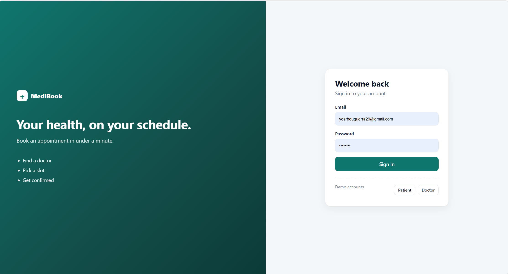
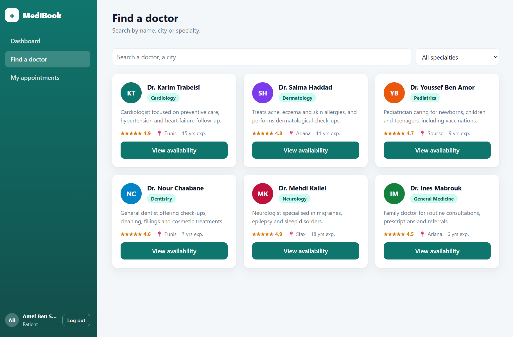
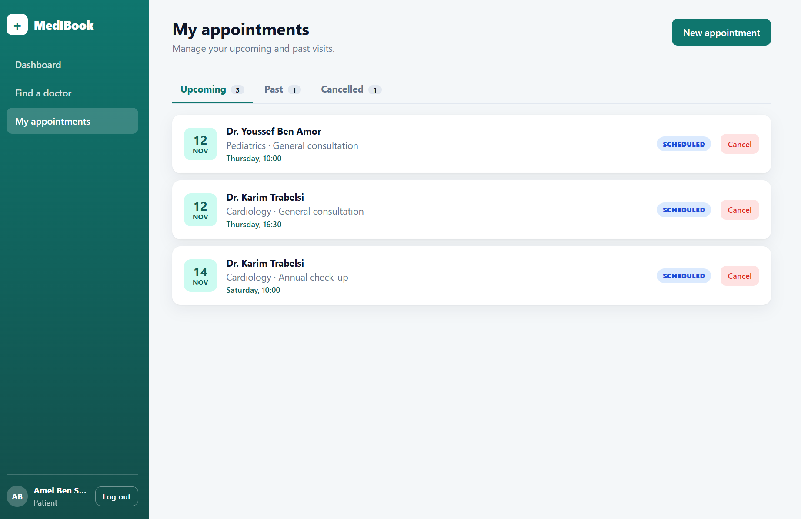

# MediBook – Web (Angular 18)


Front end of **MediBook**, a clinic appointment management platform (ASP.NET Core REST API + PostgreSQL + Angular).
## Screenshots

| Login | Find a doctor | Booking |
|-------|---------------|---------|
|  |  |  |
## Features
- JWT-style authentication with **role-based routing** (patient / doctor), route guards and an HTTP interceptor
- **Patient**: dashboard, doctor search and filters, real-time slot availability, booking, cancellation
- **Doctor**: agenda with daily stats, complete or cancel appointments
- Standalone components, signals, new control flow (`@if` / `@for`), lazy-loaded routes, reactive forms
- Responsive UI, loading skeletons, toasts, keyboard-friendly focus states
- Docker + nginx image, GitHub Actions CI

## Demo accounts
| Role    | Email                 | Password     |
|---------|-----------------------|--------------|
| Patient | patient@medibook.tn   | Patient123!  |
| Doctor  | doctor@medibook.tn    | Doctor123!   |

## Run
```bash
npm install
npm start          # http://localhost:4200
```

## Docker
```bash
docker build -t medibook-web .
docker run -p 8080:80 medibook-web   # http://localhost:8080
```

## Architecture
```
src/app
├── core      models, auth (signals + localStorage), guards, interceptor, API service, toasts
├── layout    app shell (sidebar, role-based navigation)
└── pages     login, patient dashboard, doctors, doctor detail + booking, my appointments, doctor agenda
```

`ApiService` currently runs on an in-memory data set so the UI works standalone.
Every method returns an `Observable`, so connecting the ASP.NET Core API only means
replacing the bodies with `HttpClient` calls (the interceptor already attaches the JWT).
